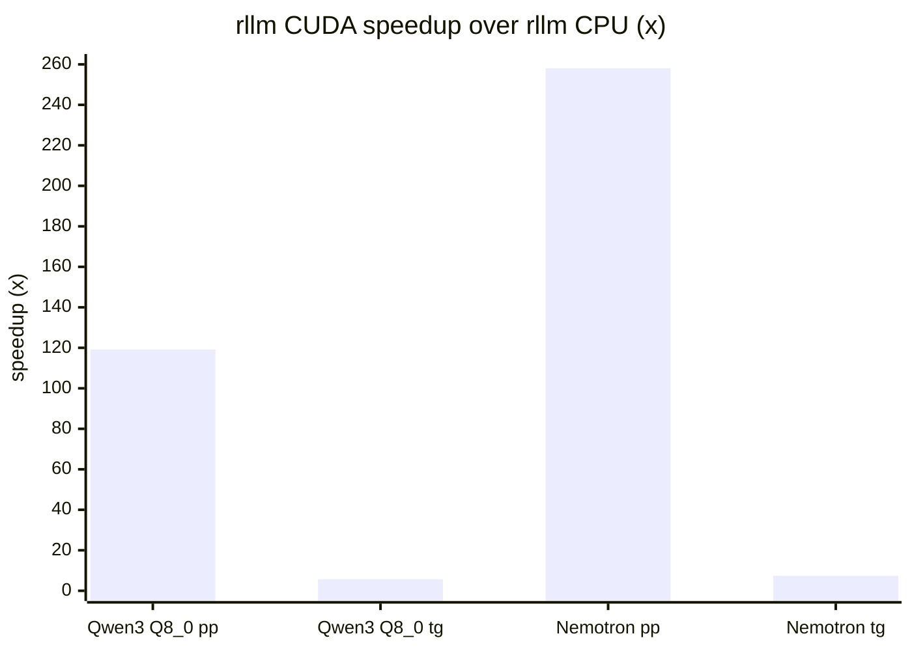
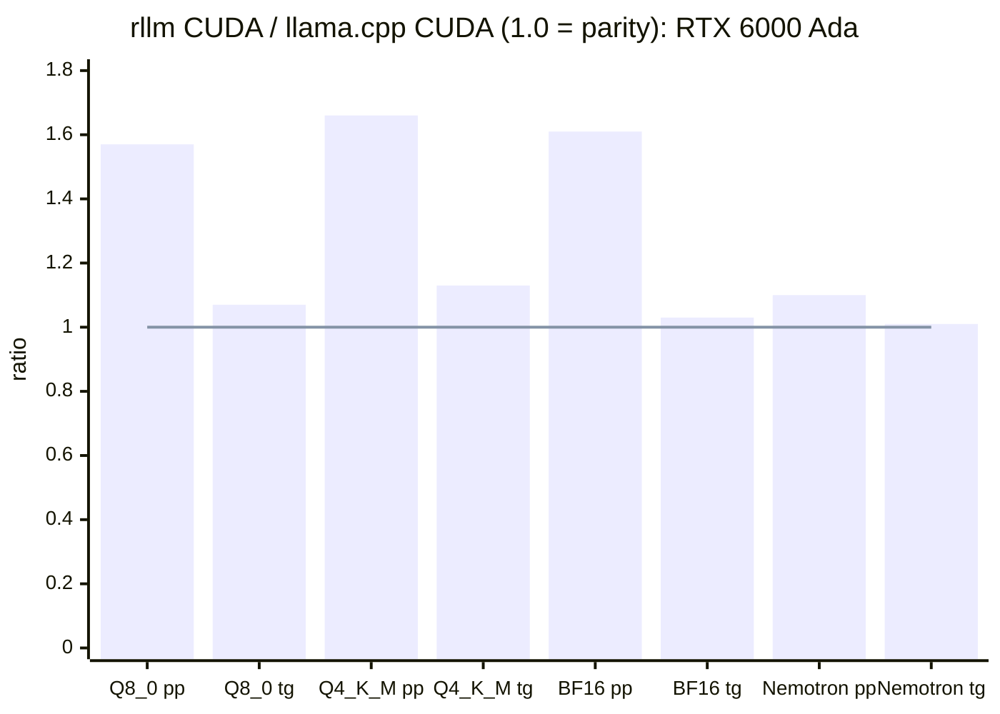
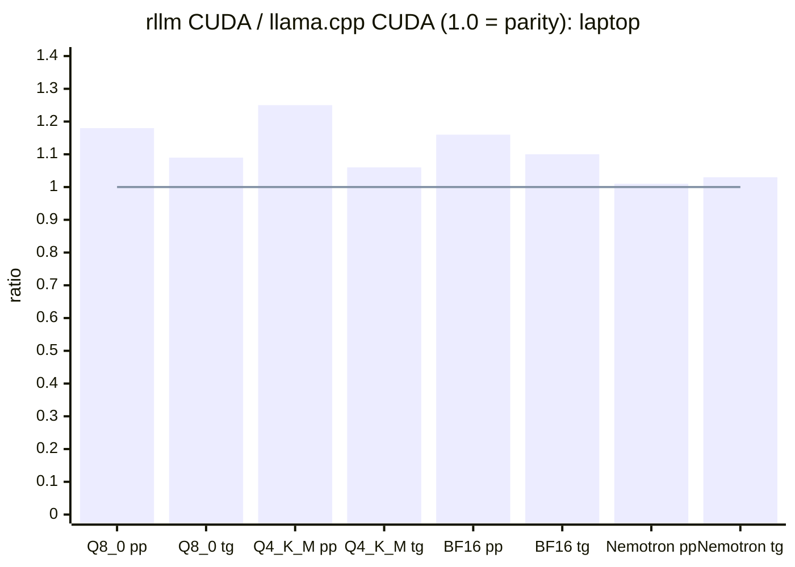

# rllm vs llama.cpp: correctness comparison

Measured 2026-10-28 (GPU sections updated 2026-10-29, including an RTX 6000 Ada) on the dev laptop (RTX PRO 3000 Blackwell, Arrow Lake CPU
with AVX2 and AVX-VNNI). Both engines ran on the CPU for the correctness
comparison. The performance section also lists rllm's CUDA numbers.

- **llama.cpp:** commit `2e0d86b`, CPU-only build.
- **rllm:** CPU backend.

Method: `tools/llama-ref` dumps llama.cpp's token ids and full logits for a prompt
plus 16 greedy tokens. `rllm compare-ref` feeds rllm the *same token ids* and
compares the two at every position. See [tools/llama-ref/README.md](tools/llama-ref/README.md).

## How to read this

The two engines can't match bit for bit:

| Step | llama.cpp (CPU) | rllm |
|---|---|---|
| Activations entering a quantized matmul | rounded to 8 bits | f32 |
| KV cache | f16 | f32 |
| Attention accumulation (flash attention) | f16 | f32 |

So the bar for "same model" is llama.cpp's **noise floor**: how much its own
logits move when only its numeric settings change. That means comparing default
settings against an f32 KV cache with flash attention off. If rllm differs from
llama.cpp by about that much, the remaining gap is numerics, not a model bug.

**Metric:** mean KL divergence between the two engines' next-token
distributions, averaged over every position (in nats; lower is closer).

## Results

| Model | Weights | Tokenization | KL: rllm vs llama.cpp | KL: rllm (llama.cpp rounding) vs llama.cpp (f32 attention) | KL: llama.cpp vs itself (noise floor) | Top-1 agreement |
|---|---|---|---:|---:|---:|---|
| Qwen3-0.6B, plain text | BF16 | identical | 8.8e-5 | 6.5e-5 | 9.4e-5 | 54/54 |
| Qwen3-0.6B, plain text | Q8_0 | identical | 9.0e-3 | 1.9e-3 | 1.3e-3 | 54/54 · 53/54 |
| Qwen3-0.6B, chat | Q8_0 | identical | 4.5e-3 | 1.4e-3 | 1.5e-3 | 35/39 · 35/39 |
| Qwen3-0.6B, plain text | Q4_K_M | identical | 9.4e-3 | 8.8e-3 | 1.25e-2 | 51/54 · 50/54 |
| Nemotron 3.5 Bolt E4B (Gemma 4), chat | Q8_0 | identical | 3.7e-3 | 6.8e-3 | 6.0e-3 | 32/35 · 31/35 |
| Nemotron, 686-token prompt (longer than the 512-token sliding window) | Q8_0 | identical | 5.4e-4 | — | — | 689/692 |
| Tokenizer stress test, both tokenizers | — | identical (130 tokens each) | — | — | — | — |

Top-1 agreement is shown for the default comparison, then for the matched-rounding
comparison. Almost every top-1 disagreement is at a low-confidence position
inside the prompt or chat template. The only disagreements in generated text
were in the Qwen3 runs, where llama.cpp's own two settings also disagree. On the
long prompt, both engines answer the retrieval question correctly ("5").

## Chart: difference relative to llama.cpp's noise floor

Each bar is rllm's KL against llama.cpp divided by llama.cpp's KL against
itself. **At or below 1.0 (the line) means rllm differs from llama.cpp no more
than llama.cpp differs from itself.**

```mermaid
xychart-beta
    title "rllm vs llama.cpp, KL / llama.cpp noise floor (<= 1.0 is within noise)"
    x-axis ["Qwen3 BF16", "Qwen3 Q8_0 plain", "Qwen3 Q8_0 chat", "Qwen3 Q4_K_M", "Nemotron Q8_0"]
    y-axis "ratio" 0 --> 7
    bar [0.93, 6.83, 3.04, 0.75, 0.61]
    bar [0.69, 1.41, 0.98, 0.70, 1.14]
    line [1, 1, 1, 1, 1]
```



The first bar in each group is rllm's default f32 numerics. The second is rllm
mimicking llama.cpp's activation rounding (`RLLM_CPU_LLAMACPP_NUMERICS=1`),
compared against llama.cpp with f32 attention.

The tall default bars for Q8_0 come from a known numeric difference, not a bug.
llama.cpp rounds activations to 8 bits before every Q8_0 matmul, and rllm
doesn't. When rllm applies the same rounding, the ratio drops to about 1.

## CUDA vs CPU reference (rllm only)

`rllm compare` runs the same tokens through the CUDA backend and the CPU
reference: the prompt in one batch, then 24 decode steps, which run through
CUDA graph replay.

| Model | Max relative logit diff | Top-1 agreement |
|---|---:|---|
| Qwen3-0.6B Q8_0 | 2.3e-2 | 25/25 |
| Qwen3-0.6B Q4_K_M | 2.6e-2 | 25/25 |
| Qwen3-0.6B BF16 | 2.8e-3 | 25/25 |
| Nemotron Q8_0 | 2.9e-2 | 25/25 |

The CUDA backend now uses the same reduced-precision shortcuts as llama.cpp's
CUDA backend:
- quantized matmuls round activations to int8
- the KV cache is f16
- prefill attention uses f16 tensor cores

So it no longer matches rllm's f32 CPU reference to 1e-6 the way the first
version did. The per-kernel parity tests (`crates/rllm-cuda/tests/parity.rs`)
check each kernel against the CPU at tolerances that match each format.

## Performance: prompt processing and generation

Same method as llama.cpp's `llama-bench`:
- **pp512 (prompt processing):** one 512-token prompt processed as a single batch.
- **tg128 (generation):** 128 tokens decoded one at a time from an empty context.

Each figure is tokens per second, mean ± standard deviation over 3 runs after
one warmup. The commands are `llama-bench -t 8 -p 512 -n 128 -r 3` and
`rllm bench -p 512 -n 128 -r 3`.

**Setup:**
- Intel Core Ultra 9 285H with 16 cores (6 performance, 8 efficient, 2
  low-power), no hyperthreading.
- Both engines run on the CPU with 8 threads. A sweep of 6, 8 and 16 threads
  found 8 fastest for both. 16 threads is slower because the efficient cores
  drag down the synchronized work. llama-bench defaults to 3 threads here.
- This section compares CPU against CPU. rllm's CUDA numbers (current, after
  the GPU optimization work) are listed for reference. For llama.cpp's own GPU backend, see
  [GPU vs GPU](#gpu-vs-gpu-llamacpp-cuda-vs-rllm-cuda) below.
- The laptop GPU runs at power-limited clocks (about 900 MHz SM under load), so
  CUDA numbers here are well below what the RTX 6000 Ada box should do.

### Prompt processing (pp512, tokens/s)

| Model | llama.cpp CPU | rllm CPU | rllm ÷ llama.cpp (CPU) | rllm CUDA |
|---|---:|---:|---:|---:|
| Qwen3-0.6B Q8_0 | 413.82 ± 2.50 | 142.72 ± 1.69 | 0.34× | 17011.01 ± 301.72 |
| Qwen3-0.6B Q4_K_M | 571.19 ± 7.40 | 145.57 ± 1.77 | 0.25× | 17225.80 ± 86.11 |
| Qwen3-0.6B BF16 | 409.74 ± 7.28 | 145.40 ± 2.30 | 0.35× | 18208.22 ± 56.88 |
| Nemotron 3.5 Bolt E4B Q8_0 (7.5B) | 66.75 ± 0.44 | 13.48 ± 0.09 | 0.20× | 3479.10 ± 29.20 |

### Generation (tg128, tokens/s)

| Model | llama.cpp CPU | rllm CPU | rllm ÷ llama.cpp (CPU) | rllm CUDA |
|---|---:|---:|---:|---:|
| Qwen3-0.6B Q8_0 | 53.90 ± 0.56 | 42.03 ± 0.41 | 0.78× | 238.13 ± 0.94 |
| Qwen3-0.6B Q4_K_M | 69.95 ± 1.37 | 34.08 ± 0.18 | 0.49× | 279.45 ± 0.30 |
| Qwen3-0.6B BF16 | 32.30 ± 0.53 | 30.20 ± 0.21 | 0.94× | 164.98 ± 0.21 |
| Nemotron 3.5 Bolt E4B Q8_0 (7.5B) | 8.84 ± 0.11 | 6.24 ± 0.06 | 0.71× | 46.13 ± 1.63 |

### Charts (CPU vs CPU)

The first bar in each group is llama.cpp, the second is rllm.

```mermaid
xychart-beta
    title "Prompt processing, pp512 on CPU (tokens/s, higher is better)"
    x-axis ["Qwen3 Q8_0", "Qwen3 Q4_K_M", "Qwen3 BF16", "Nemotron Q8_0"]
    y-axis "tokens/s" 0 --> 600
    bar [413.82, 571.19, 409.74, 66.75]
    bar [142.72, 145.57, 145.40, 13.48]
```

```mermaid
xychart-beta
    title "Generation, tg128 on CPU (tokens/s, higher is better)"
    x-axis ["Qwen3 Q8_0", "Qwen3 Q4_K_M", "Qwen3 BF16", "Nemotron Q8_0"]
    y-axis "tokens/s" 0 --> 75
    bar [53.90, 69.95, 32.30, 8.84]
    bar [42.03, 34.08, 30.20, 6.24]
```





### rllm CUDA vs rllm CPU



### Reading the numbers

- **Generation on CPU is within reach.** rllm reaches 0.49–0.94× llama.cpp.
  Decode is limited by memory bandwidth, and both engines read every weight once
  per token. The gap is widest on Q4_K. llama.cpp multiplies the 4-bit values
  directly with integer instructions (AVX-VNNI), while rllm's CPU backend first
  expands each weight row to f32.
- **Prompt processing on CPU is 3–5× behind.** rllm's CPU backend is the
  correctness reference: it expands one weight row at a time and does plain f32
  dot products. llama.cpp uses repacked weights, 8-bit integer matrix kernels and
  cache-blocked GEMM. Closing this gap is optimization work on the CPU backend,
  not a correctness issue.
- **rllm on CUDA** is 118–258× faster than rllm's CPU backend for prompt
  processing and 5.5–8.2× for generation, even at this laptop's power-limited
  clocks. See the GPU section below for how it compares with llama.cpp's CUDA
  backend.

## GPU vs GPU: llama.cpp CUDA vs rllm CUDA

Two GPUs:

| | Laptop | Benchmark box |
|---|---|---|
| GPU | RTX PRO 3000 Blackwell Laptop (sm_120, 46 SMs) | RTX 6000 Ada (sm_89, 142 SMs, 48 GB) |
| Clocks | power-limited, about 1 GHz SM | up to 3.1 GHz SM, 300 W |
| CPU | Core Ultra 9 285H | Core i9-14900K |
| OS | Fedora 45 | Fedora 44 |

**How llama.cpp's CUDA backend was built:** CUDA 13.4 toolkit (nvcc, ptxas,
NVVM, cudart, CCCL, cuBLAS) assembled from NVIDIA's PyPI packages into
`.cuda/tk`, since there's no system toolkit and no sudo. Host compiler GCC
16.2, llama.cpp `2e0d86b`. The laptop build targets `sm_120a`
(`third_party/llama.cpp/build-cuda`). The Ada build
(`build-cuda89`) targets `sm_89` with `GGML_NATIVE=OFF` (AVX2, AVX-VNNI, FMA,
F16C) and `LLAMA_OPENSSL=OFF`, so the binaries run on the box's Fedora 44.
The box has no Rust or CUDA toolchain: rllm, llama.cpp and their CUDA
libraries were built on the laptop and copied to `~/rllm-bench` there (rllm
compiles its kernels for sm_89 with NVRTC on first run).

**How it was run:**
- llama.cpp: `llama-bench -ngl 99 -p 512 -n 128 -r 3` with default settings
  (flash attention on auto, f16 KV cache).
- rllm: `rllm bench -d cuda -r 3`.
- Each model ran llama.cpp then rllm back to back, so both see the same
  thermal state.
- The Ada box also runs an idle `llama-server` (32 GB, 0% utilization during
  the runs; checked before and after).

### Speed on the RTX 6000 Ada (tokens/s)

Final run, 2026-10-29.

| Model | pp512, llama.cpp CUDA | pp512, rllm CUDA | pp512, rllm ÷ llama.cpp | tg128, llama.cpp CUDA | tg128, rllm CUDA | tg128, rllm ÷ llama.cpp |
|---|---:|---:|---:|---:|---:|---:|
| Qwen3-0.6B Q8_0 | 47280.77 ± 10369.29 | 74120.87 ± 52.46 | **1.57×** | 636.16 ± 16.45 | 683.42 ± 0.52 | **1.07×** |
| Qwen3-0.6B Q4_K_M | 45029.89 ± 9279.18 | 74905.97 ± 53.60 | **1.66×** | 718.24 ± 10.93 | 809.21 ± 0.42 | **1.13×** |
| Qwen3-0.6B BF16 | 52833.88 ± 14033.81 | 84889.99 ± 67.86 | **1.61×** | 478.44 ± 2.44 | 493.86 ± 2.01 | **1.03×** |
| Nemotron 3.5 Bolt E4B Q8_0 (7.5B) | 12641.96 ± 696.79 | 13943.39 ± 273.69 | **1.10×** | 129.59 ± 0.27 | 131.34 ± 0.03 | **1.01×** |

llama.cpp's prompt numbers on the 0.6B model swing by ±20% between its three
repetitions; rllm's don't. The BF16 and Nemotron rows were re-run back to
back after the last decode changes (float-weight fused FFN; fused
norm + gate/up for Gemma). Nemotron generation is 1.014× (131.34 ± 0.03 vs
129.59 ± 0.27), outside both engines' spread; a 64-chunk perplexity check
after the change gave 114.64 vs llama.cpp's 114.86.

**The Ada found problems the laptop hid.** At 3 GHz a decode step is 1.5–8 ms,
so fixed per-token costs that were invisible at 1 GHz showed up. The first Ada
run had rllm at 0.68× llama.cpp for Nemotron generation and 0.95–0.97× for the
Qwen3 models; the fixes are in the table below (the rows marked *Ada*).

### Speed on the laptop (tokens/s)

Final run, 2026-10-29, both engines back to back per model. The SM clock was
about 1 GHz, and the laptop ran warmer than in earlier runs, so absolute
numbers are lower than before for both engines. Run-to-run spread here is
about ±3%, so ratios within a few percent of 1.0 are ties.

| Model | pp512, llama.cpp CUDA | pp512, rllm CUDA | pp512, rllm ÷ llama.cpp | tg128, llama.cpp CUDA | tg128, rllm CUDA | tg128, rllm ÷ llama.cpp |
|---|---:|---:|---:|---:|---:|---:|
| Qwen3-0.6B Q8_0 | 14357.03 ± 619.89 | 17011.01 ± 301.72 | **1.18×** | 218.53 ± 0.89 | 238.13 ± 0.94 | **1.09×** |
| Qwen3-0.6B Q4_K_M | 13742.72 ± 940.56 | 17225.80 ± 86.11 | **1.25×** | 264.12 ± 0.88 | 279.45 ± 0.30 | **1.06×** |
| Qwen3-0.6B BF16 | 15750.89 ± 619.57 | 18208.22 ± 56.88 | **1.16×** | 150.54 ± 0.88 | 164.98 ± 0.21 | **1.10×** |
| Nemotron 3.5 Bolt E4B Q8_0 (7.5B) | 3428.00 ± 23.30 | 3479.10 ± 29.20 | 1.01× | 44.93 ± 1.74 | 46.13 ± 1.63 | 1.03× |

Nemotron on the laptop is a tie within noise in this run; the previous run,
in a cooler state, measured 1.04× for prompt processing.

**Before and after the GPU work** (rllm CUDA on the laptop):

| Model | pp512 before | pp512 after | speedup | tg128 before | tg128 after | speedup |
|---|---:|---:|---:|---:|---:|---:|
| Qwen3-0.6B Q8_0 | 2333.69 | 17011.01 | 7.3× | 108.72 | 238.13 | 2.2× |
| Qwen3-0.6B Q4_K_M | 2345.30 | 17225.80 | 7.3× | 102.34 | 279.45 | 2.7× |
| Qwen3-0.6B BF16 | 2322.38 | 18208.22 | 7.8× | 112.06 | 164.98 | 1.5× |
| Nemotron Q8_0 | 703.46 | 3479.10 | 4.9× | 19.41 | 46.13 | 2.4× |

### Charts

The first bar in each group is llama.cpp CUDA, the second is rllm CUDA.

```mermaid
xychart-beta
    title "RTX 6000 Ada: prompt processing, pp512 (tokens/s)"
    x-axis ["Qwen3 Q8_0", "Qwen3 Q4_K_M", "Qwen3 BF16", "Nemotron Q8_0"]
    y-axis "tokens/s" 0 --> 90000
    bar [47280.77, 45029.89, 52833.88, 12641.96]
    bar [74120.87, 74905.97, 84889.99, 13943.39]
```

```mermaid
xychart-beta
    title "RTX 6000 Ada: generation, tg128 (tokens/s)"
    x-axis ["Qwen3 Q8_0", "Qwen3 Q4_K_M", "Qwen3 BF16", "Nemotron Q8_0"]
    y-axis "tokens/s" 0 --> 900
    bar [636.16, 718.24, 478.44, 129.59]
    bar [683.42, 809.21, 493.86, 131.34]
```









### Correctness on GPU

`llama_ref` was built against each CUDA build and run with all layers on the
GPU, then compared with `rllm compare-ref -d cuda` on the same machine. The
noise floor is llama.cpp's own CUDA output vs its own CPU output on the same
prompt.

| Model | KL: rllm vs llama.cpp, laptop | Floor, laptop | Top-1, laptop | KL: rllm vs llama.cpp, Ada | Floor, Ada | Top-1, Ada |
|---|---:|---:|---|---:|---:|---|
| Qwen3-0.6B Q8_0 | 8.93e-3 | 1.60e-3 | 52/54 | 8.37e-3 | 1.16e-3 | 54/54 |
| Qwen3-0.6B Q4_K_M | 1.20e-2 | 2.40e-2 | 52/54 | 1.16e-2 | 7.08e-3 | 51/54 |
| Qwen3-0.6B BF16 | 1.28e-4 | 1.23e-4 | 54/54 | 8.44e-5 | 4.61e-5 | 54/54 |
| Nemotron Q8_0, chat | 4.4e-3 – 5.2e-3 (4 runs) | 4.13e-3 | 33–35/35 | 6.3e-3 – 6.9e-3 (2 runs) | 5.59e-3 | 34/35 |
| Nemotron Q8_0, 686-token prompt | 5.3e-4 | — | 701/702 | — | — | — |

Tokenization is identical in every case. `rllm compare` (CUDA vs rllm's CPU
reference) also passes on the Ada: no top-1 disagreements on Q4_K_M, BF16 and
Nemotron over 25 steps, and one on Q8_0, at a position where the CPU
reference's top two tokens are 0.029 logits apart.

- **Nemotron is about 1.1–1.2× llama.cpp's floor on both GPUs; BF16 is at it
  in absolute terms (KL below 1e-4).** rllm's CUDA output varies slightly from
  run to run: split-K matmuls sum partial results with `atomicAdd`, whose
  order isn't fixed. On the 35-position chat prompt that moved the KL between
  3.5e-3 and 6.8e-3 across recent builds, so single readings understate the
  spread.
- **Q8_0 sits above the floor,** as in every comparison since the start, and
  Q4_K_M is above the (smaller) Ada floor. The disagreements are at
  low-confidence positions in the prompt; generated text matches.

### Perplexity (wikitext-2 test set, RTX 6000 Ada)

`rllm perplexity` uses llama-perplexity's method: tokenize the whole file
once, cut it into 512-token chunks, start each chunk with BOS when the model
uses one, and score the second half of each chunk (255 next-token predictions
per chunk). Both engines ran on the full `wiki.test.raw` from wikitext-2-raw-v1
with `-c 512`, all layers on the GPU:

| Model | Chunks | llama.cpp CUDA | rllm CUDA | rllm − llama.cpp |
|---|---:|---:|---:|---:|
| Qwen3-0.6B Q8_0 | 584 | 21.9497 ± 0.19166 | 21.9569 ± 0.19191 | +0.03% |
| Qwen3-0.6B Q4_K_M | 584 | 22.9116 ± 0.20046 | 22.7416 ± 0.19891 | −0.74% |
| Qwen3-0.6B BF16 | 584 | 21.8891 ± 0.19150 | 21.8864 ± 0.19148 | −0.01% |
| Nemotron 3.5 Bolt E4B Q8_0 | 576 | 128.4028 ± 1.86834 | 128.3503 ± 1.86730 | −0.04% |

Same chunk counts, so the tokenizations agree over the whole file. Every
difference is far inside the ± (the standard error, computed the same way
by both tools). Nemotron's high value is the model's, not rllm's: it is a
chat model scored on raw encyclopedia text, and llama.cpp gives the same
number. A short laptop check (8 chunks, Qwen3 Q8_0) gave 21.66 vs 21.62.

```sh
rllm perplexity model.gguf wiki.test.raw -c 512 [--chunks N] [-d cuda|cpu]
llama-perplexity -m model.gguf -f wiki.test.raw -c 512 -ngl 99
```

### What was fixed

The first GPU-vs-GPU run found rllm at 0.13–0.21× llama.cpp for prompt
processing and 0.38–0.75× for generation. Changes, roughly in order of impact:

| Area | Problem found | Fix |
|---|---|---|
| Prefill attention | 57% of prefill time; one block per token-head walking positions one at a time | FlashAttention-2-style kernels `attn_fa_d{64,128,256,512}`: `mma.m16n8k16`, online softmax, K/V shared across the GQA group, `cp.async` double-buffered K/V tiles, `ldmatrix(.trans)` fragment loads, per-head-dim tile and warp layouts |
| Decode attention | One block per query head, a shuffle reduction per position, serial V loads | `attn_decode_g{G}_d{HD}`: one block per KV head serving its whole GQA group, lane-per-position scoring, batched V loads, templated so state stays in registers |
| Decode matvec | Byte-wise reads of GGUF blocks, about 35–130 GB/s | Weights repacked on upload into aligned device formats; int8 activations with `dp4a` (same idea as llama.cpp's MMVQ); Q/K/V and gate/up share one quantization and one launch (`matmul_many`) |
| KV cache | f32: double the attention bandwidth and memory | f16 KV cache; f16 staging is now plain 16-byte copies |
| Prefill matmuls | Every weight re-expanded to f16 on every pass | int8 tensor-core MMQ (`mma.m16n8k32`, `ldmatrix` fragments, 128×64 block tiles, split-K picked by a wave-cost model) for quantized weights of 4M+ elements; BF16 weights passed to cuBLAS as-is; f16 copies of small f32 matrices; 32 MB cuBLAS workspace |
| Activation quantization | A separate quantize launch before every quantized matmul | Quantization fused into the producing kernels (norms, `qkv_norm_rope_store`, the FFN kernels, and on large GPUs prefill attention), only where a consumer reads the int8 copy; the f32 output is skipped when nothing reads it. The standalone `quantize_q8` uses 8 lanes per 32-value unit with vector loads (37 → 18 µs per call) |
| Prefill attention output (*Ada*) | One standalone quantize launch per layer before the output projection | On GPUs with 80+ SMs the FlashAttention epilogue stages each warp's output slab in the freed K/V shared memory and writes the int8 copy (one lane per 32-value unit): +2% Nemotron prefill on the RTX 6000 Ada. On the 46-SM laptop the same epilogue measured 1.2% slower, so there it stays a separate launch (`RLLM_FA_QUANT=0/1` overrides) |
| FFN, prefill | gate, up, activation and down as separate launches with f32 intermediates | `mmq_glu_*` computes gate and up in one MMQ (each block holds 64 gate rows and the matching 64 up rows), stages both in shared memory (one swizzled 32 KB buffer, so 3 blocks per SM still fit), and each thread applies SiLU/GELU and writes one 32-value unit of the down projection's int8 input. Its cost is within 1% of a plain MMQ of the same size |
| FFN, decode (*Ada*) | gate/up matvec, then a separate activation launch per layer | `matvec_glu_*`: for quantized weights, 32 rows per block, each warp computes its gate and up rows, and the block writes the down projection's int8 input directly; for F16/BF16/F32 weights, each warp writes act(gate) * up (BF16 decode on the Ada +1.7%) |
| Logit softcap (*Ada*) | Gemma's `cap * tanh(x / cap)` ran on the host over all 262,144 logits every token: about 3 ms per token at Ada speeds | `softcap` backend op, run on the GPU before the copy (Nemotron decode on the Ada 88 → 123 tok/s) |
| Per-step host overhead (*Ada*) | The decode graph launched only after the host had walked all ops for the step (240 µs per Qwen step), and every op read environment variables | Debug switches read once at startup; the replay graph launches as soon as the step's last index array is written, so the remaining walk overlaps the GPU; models skip the identity logits gather in decode |
| Gemma post-attention norm, decode (*Ada*) | A one-row `rms_norm_add` launch between the attention output projection and the FFN | `norm_add_gated_ffn`: the gate/up matvec blocks recompute the residual update and the FFN norm in a prologue and read the int8 input from shared memory (`matvec_glu_norm_*`); the residual moves to a second buffer and back, so no block overwrites what another reads (+0.7% Nemotron decode on the Ada) |
| Gemma per-layer inputs, decode (*Ada*) | Four small launches per layer (norm, F32 matvec, gather, activation), each mostly launch latency | `ple_gate`: one kernel recomputes the cheap norm per block, does the 256×2560 matvec with 4 warps per row, and applies the gated activation in its epilogue |
| Float matvec | One warp per row left most SMs idle on 256-row weights | Rows split across 4 warps when rows are few (kw is a template parameter: a runtime stride cost the common case 10%) |
| Ada (sm_89) codegen | The plain MMQ kernels kept their 64 accumulators in a 256-byte local-memory stack frame on sm_89 (not on sm_120); `rms_norm_add` needed 96 registers × 1024 threads and failed to launch (`CUDA_ERROR_LAUNCH_OUT_OF_RESOURCES`) on the real card | Store loops fully unrolled; `__launch_bounds__(1024)` on the norm kernels. A unit test compiles all kernels for sm_89 and sm_86, and `ptxas -arch=sm_89` shows no stack frames or spills |
| Norms | `rms_norm_add` used 1024 threads for 2560-wide rows and re-read its inputs | Row values kept in registers, 8 per thread (prefill 94 → 62 µs per call); decode-sized calls keep wide blocks |
| Split-K | Fixed 5% cost per extra split | Penalty scaled by 2560 / k, so long-k matmuls (the FFN down projection) split further |
| Launch overhead | about 25 kernels per layer, fresh allocations per step | Fused add+RMSNorm, RMSNorm+RoPE, Q/K-norm+RoPE+KV-store, and Gemma's post-norm+residual+next-norm; CUDA graphs for decode steps (arena allocations, pinned index uploads captured as memcpy nodes, graphs invalidated when a captured buffer is reallocated) |
| Startup | NVRTC compile about 6 s per run | Compiled PTX cached in `~/.cache/rllm/ptx` (startup about 0.7 s) |

Tried and reverted because they measured slower: pinned staging for the
logits copy (cudarc's pinned memory is write-combined, so reading it on the
host halved Nemotron decode), split-k and unrolling for the quantized matvec
(no change), and the fused attention-output quantization described below.

One bug was found and fixed along the way. Pinned staging buffers for index
uploads were reused before their asynchronous copy had run. cudarc's own guard
for this is off, because event tracking is disabled context-wide. This
corrupted Gemma prefill once prompts had several attention tiles. It's now
guarded with per-buffer events, and `index_reupload_back_to_back` covers it.

Debug switches: `RLLM_PROFILE=1` gives a per-kernel event profile;
`RLLM_NO_GRAPHS=1`, `RLLM_MMQ=0|1`, `RLLM_MMQ_MIN=<elements>`, `RLLM_NO_FA=1`,
`RLLM_NO_TC_ATTN=1`, `RLLM_NO_FUSED_QUANT=1`, `RLLM_NO_GLU_MMQ=1` (prefill and
decode fused FFN), `RLLM_FA_QUANT=0|1` and `RLLM_BF16_VIA_F16=1` force alternative paths for A/B
checks. They are read once at startup.

## Serving: `rllm serve` vs `llama-server` (RTX 6000 Ada)

Run 2026-10-29. Both servers loaded the same GGUF on the RTX 6000 Ada:
- **llama.cpp:** `llama-server` from the same sm_89 build as above, `-ngl 99 -fa on -np 8 -c 32768`.
- **rllm:** `rllm serve --parallel 8 --ctx 4096`.

The client was a standard-library Python script on the same machine, so no network was involved. It made streaming chat completions, greedy, with the end-of-turn tokens biased away so every request runs to its full length. Scenarios:
- one request at a time: a 540–670-token prompt, 256 tokens out, median of 3
- 1, 4 and 8 concurrent clients: 2 requests each, about 120-token prompts, 192 tokens out
- a 4-turn chat on a 2–2.6k-token system prompt

The docker `llama-server` on the box was idle throughout.

| | Qwen3-0.6B Q8_0, llama-server | Qwen3-0.6B Q8_0, rllm | rllm ÷ llama | Nemotron E4B Q8_0, llama-server | Nemotron E4B Q8_0, rllm | rllm ÷ llama |
|---|---:|---:|---:|---:|---:|---:|
| Single request: time to first token | 103 ms | 13 ms | 7.9× faster | 130 ms | 49 ms | 2.7× faster |
| Single request: decode, tok/s | 490.8 | 547.4 | **1.12×** | 118.5 | 119.8 | **1.01×** |
| 1 client: total output, tok/s | 432 | 650 | **1.50×** | 115 | 127 | **1.10×** |
| 4 clients: total output, tok/s | 545 | 1874 | **3.44×** | 233 | 450 | **1.93×** |
| 8 clients: total output, tok/s | 1176 | 2760 | **2.35×** | 485 | 744 | **1.53×** |
| 8 clients: mean time to first token | 262 ms | 14 ms | | 305 ms | 58 ms | |
| Chat, turn 1: time to first token | 338 ms | 50 ms | | 385 ms | 170 ms | |
| Chat, turns 2–4: time to first token | 16–17 ms | 12–13 ms | | 99–107 ms | 19–20 ms | |

Notes:
- **Prefix reuse:** both servers reuse the cached chat prefix on later turns. llama-server's Nemotron turns still took about 100 ms, presumably because its sliding-window cache can't be reused across turns.
- **How rllm batches:** decode steps of up to 8 requests replay CUDA graphs; each forward pass also takes one prompt chunk; requests are sampled on separate threads. See `docs/server.md` for the design.
- **Batching numerics:** batched requests run the multi-row int8 kernels (the ones prefill uses), so their logprobs differ from a lone request's by about 0.01–0.02 on average.
- **Fixes during this benchmark:**
  - Server per-token overhead was first 0.6 ms on Nemotron (8.25 ms per step against 7.63 ms for raw decode). The causes were a 1 MB logits copy per token, a scalar argmax, and the engine thread landing on E-cores.
  - Sampling now works in place and is vectorized, and the engine thread pins itself to the P-cores. A step now takes 7.69 ms.
  - Temperature sampling over the 262k vocabulary went from 0.86 to 0.08 ms per token (laptop CPU).

## Known gaps

- **Prefill activation quantization on small GPUs:** on the RTX 6000 Ada no
  standalone quantize launch remains (decode or prefill). On the 46-SM laptop
  GPU prefill keeps one per layer (the attention output, about 18 µs), because
  all three fused designs measured slower there (0.5–1.2%); the fused path is
  enabled from 80 SMs up.
- **Close margins:** Nemotron generation on the Ada (1.01×) and Nemotron on
  the laptop are the closest results; small changes in either engine could
  flip them.
- **Laptop numbers at the end of the session:** the laptop's battery ran down
  to 13% and the GPU was power-capped (both rllm builds then measured the same
  ~12 tok/s), so the last decode change (float-weight fused FFN) was
  benchmarked on the Ada only; the laptop table is from the run before it.
- **Run-to-run variation on CUDA:** split-K accumulates with `atomicAdd`, so
  logits differ slightly between runs (see "Correctness on GPU"). A
  deterministic reduction (like llama.cpp's stream-k fixup) would remove it.
- **Q4_K on CPU:** emulating llama.cpp's activation rounding doesn't narrow the
  gap. llama.cpp uses repacked Q4_K kernels on AVX2, whose rounding isn't
  mirrored. The gap is still within llama.cpp's own noise floor.
- **CPU backend speed:** the CPU backend is the f32 correctness reference and
  has not been optimized (see the CPU tables above).
- **Not built yet:** tensor parallelism across GPUs (the 2× RTX 4500 Ada setup
  in `docs/plan.md` is a later phase), so there is nothing to benchmark there
  yet.
