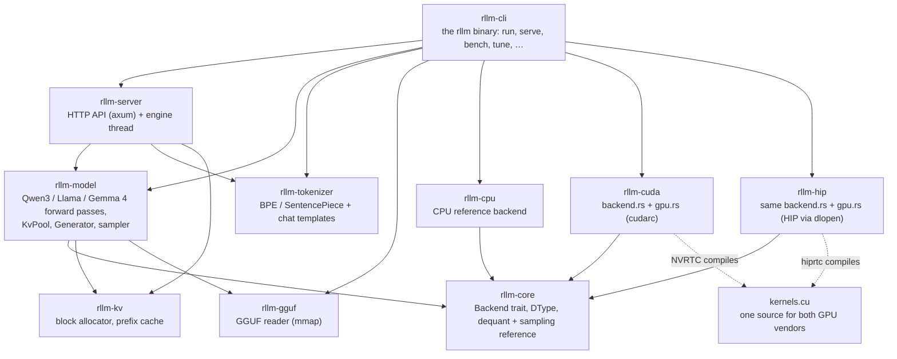
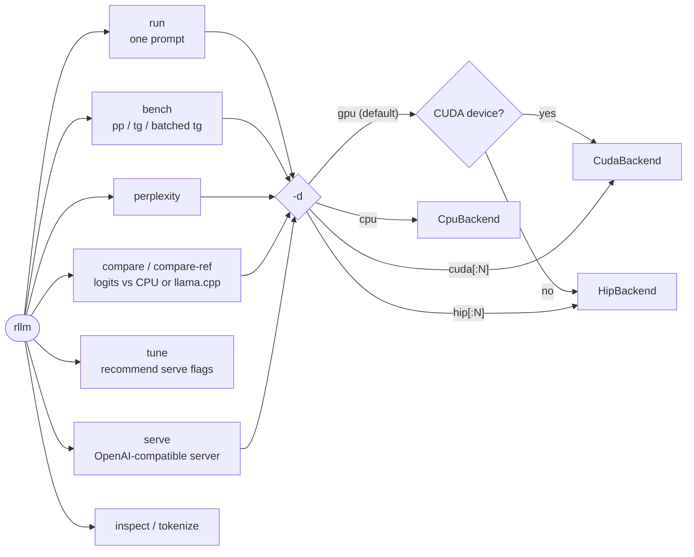
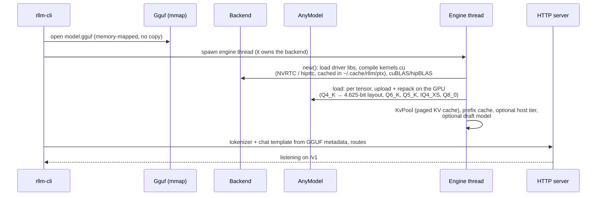
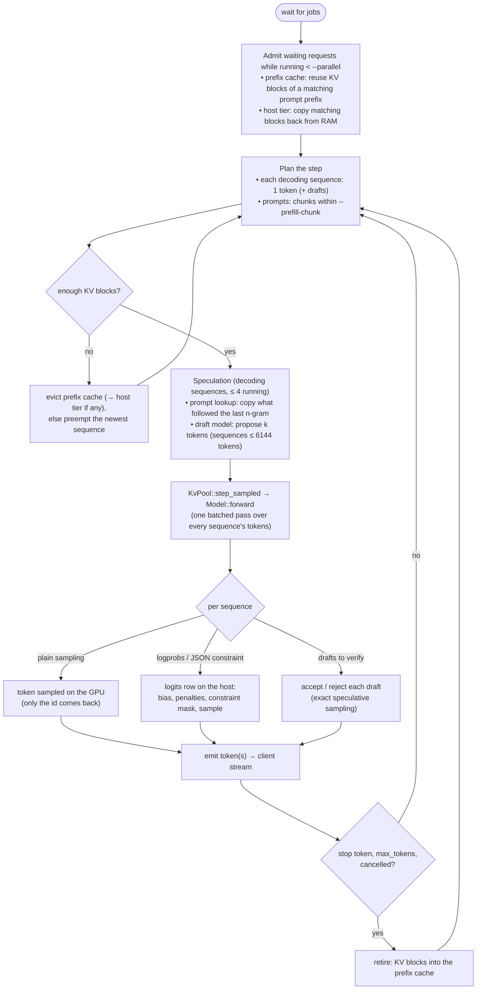
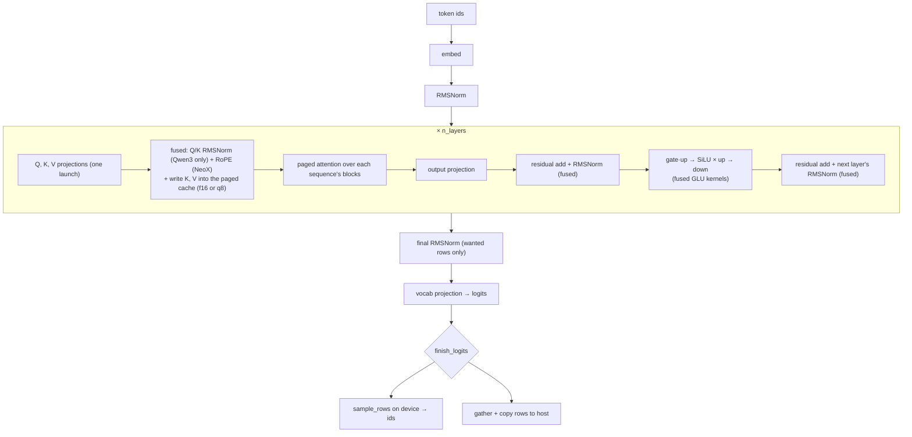
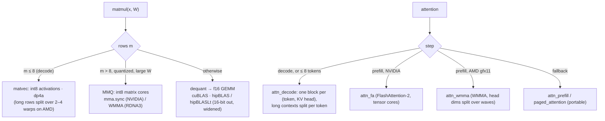

# How rllm works

This file follows rllm from the command line down to the GPU kernels. The
diagrams are Mermaid, which GitHub renders. File names point to where each
step lives.

## 1. Crates



Models are written against the `Backend` trait in `rllm-core`. The three
backends implement it, so the same model code runs on the CPU, NVIDIA and
AMD.

## 2. Commands



`Device::parse` and the `on_device!` macro in `rllm-cli/src/main.rs` pick the
backend. Each command is a generic function over `B: Backend`.

## 3. Startup (`rllm serve`)



## 4. Lifecycle of a chat request

```mermaid
sequenceDiagram
    participant C as Client
    participant A as Handler (chat.rs)
    participant T as Tokenizer
    participant Gn as generation.rs
    participant E as Engine (engine.rs)

    C->>A: POST /v1/chat/completions
    A->>A: parse params (params.rs): sampling, tools,<br/>response_format → JSON constraint
    A->>T: render chat template (minijinja), encode
    A->>Gn: generate(prompt ids, GenParams)
    Gn->>E: submit Job::Generate (mpsc channel)
    loop every engine step
        E-->>Gn: GenEvent::Token {id, logprobs}
        Gn-->>A: detokenize incrementally; parse reasoning / tool calls (output.rs)
        A-->>C: SSE chunk (or buffered for non-streaming)
    end
    E-->>Gn: GenEvent::Done(stop | length | cancelled)
    A-->>C: final chunk + usage
```

`/v1/completions`, `/v1/responses` and `/v1/embeddings` follow the same path
with their own request and response shapes. Embeddings are a
`Job::Embed` that returns hidden states instead of tokens.

## 5. The engine loop (continuous batching)

One thread runs the loop, owns the backend and the KV pool, and serves every
request.



`Scheduler::step` in `rllm-server/src/engine.rs` runs this loop. Metrics are
exposed at `/metrics`.

## 6. One forward pass (dense decoder: Qwen3, Llama, Mistral)



Gemma 4 (`gemma4.rs`) has the same outline plus its extras: sliding-window
and global layers with two KV pools, per-layer embeddings, logit soft-cap,
GELU, and 256/512-wide heads. For Llama, the Q/K rows are reordered at load
time so the NeoX RoPE kernel applies to them.

Steps of up to 8 tokens, and pure decode steps of up to 64 tokens, are
recorded once as a CUDA/HIP graph. Later steps with the same shape replay
that graph instead of launching about 300 kernels from the host.

## 7. Inside the backend: which kernel runs



`rllm-cuda/src/backend.rs` holds all of this logic once. Each crate compiles
it against its own `gpu` module (`rllm-cuda/src/gpu.rs` or
`rllm-hip/src/gpu.rs`), which supplies streams, memory, launches, graphs and
BLAS. Vendor differences are small flags in that module, such as
`GEMM_HALF_OUT`, `MATVEC_SPLIT_K` and `wmma`, and `#ifdef RLLM_HIP` blocks in
`kernels.cu`.

## 8. Correctness checks along the flow

| Where | Check |
|---|---|
| Every GPU kernel | `tests/common/parity.rs`: GPU against the CPU reference on random inputs (CUDA and HIP) |
| Whole model | `rllm compare` (CPU logits at each step), `rllm compare-ref` (llama.cpp logit dumps), `rllm perplexity` |
| Engine invariants | `rllm-model/tests/common/gpu.rs`: deterministic steps, verification = single steps, q8 tracks f16, host tier round trip |
| Server | stress test (30k-token prompt + 7 concurrent requests), prompt lookup, host tier, concurrency benchmark (`compare.md`) |
