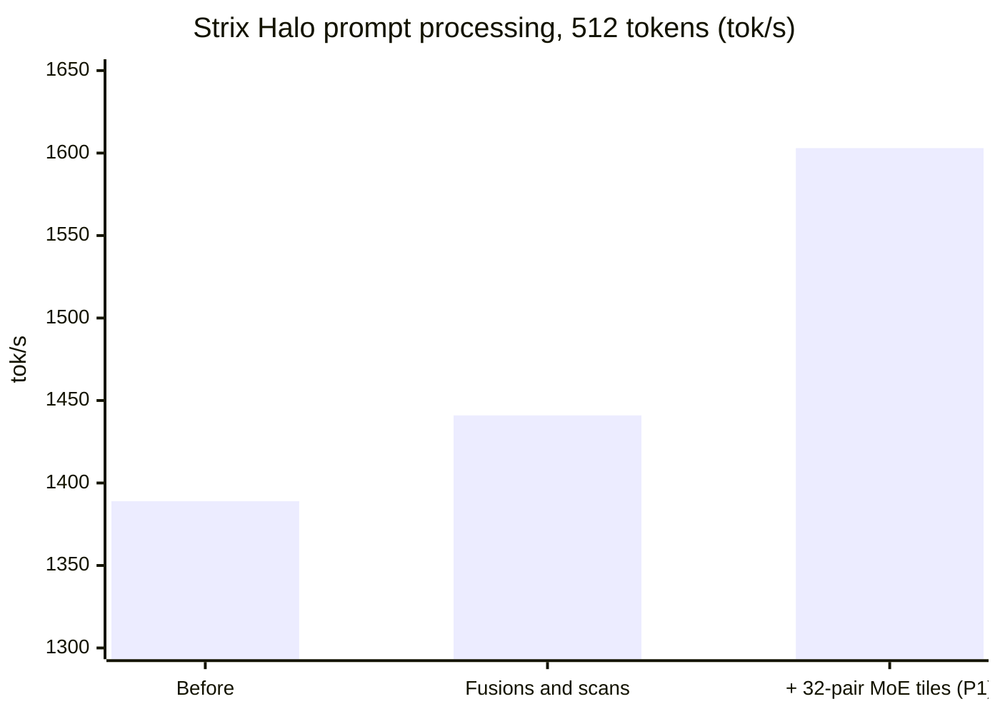
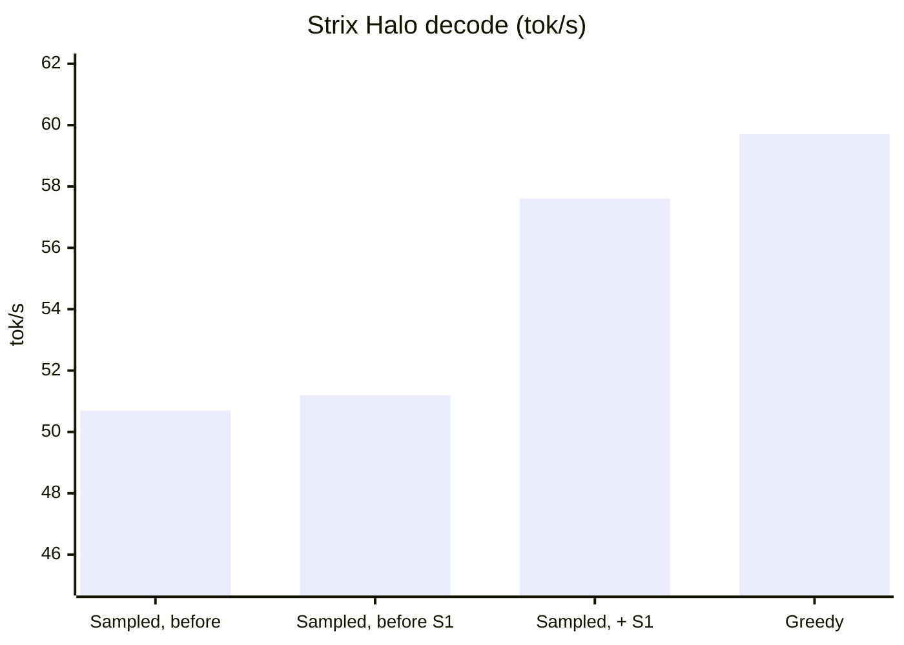
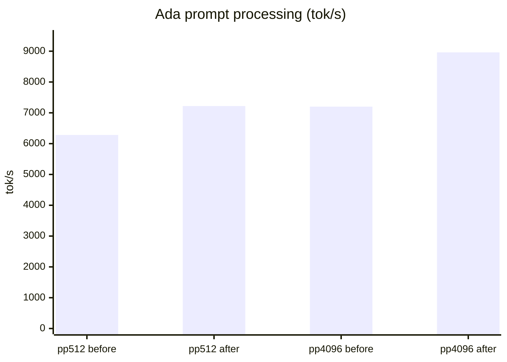
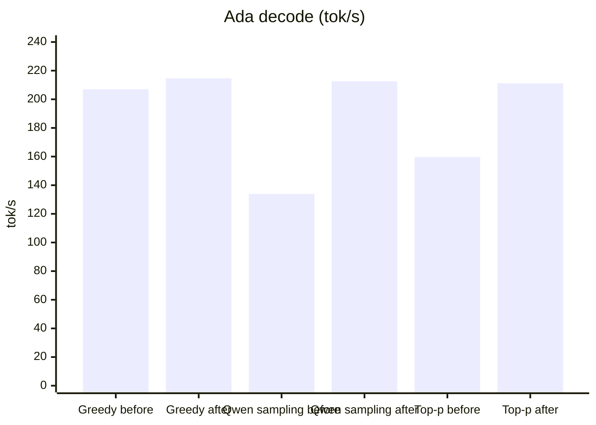
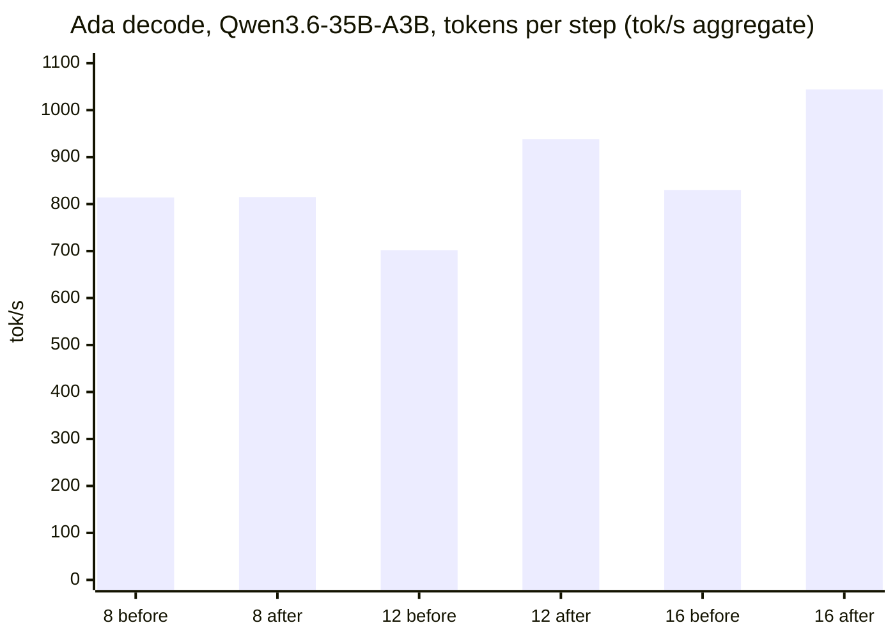
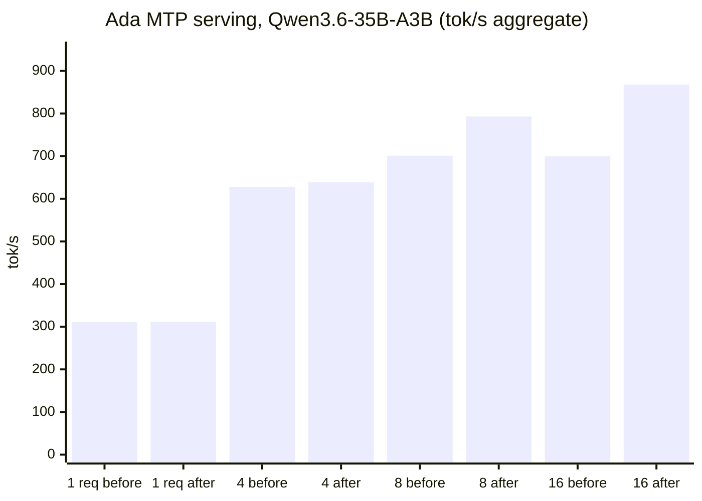
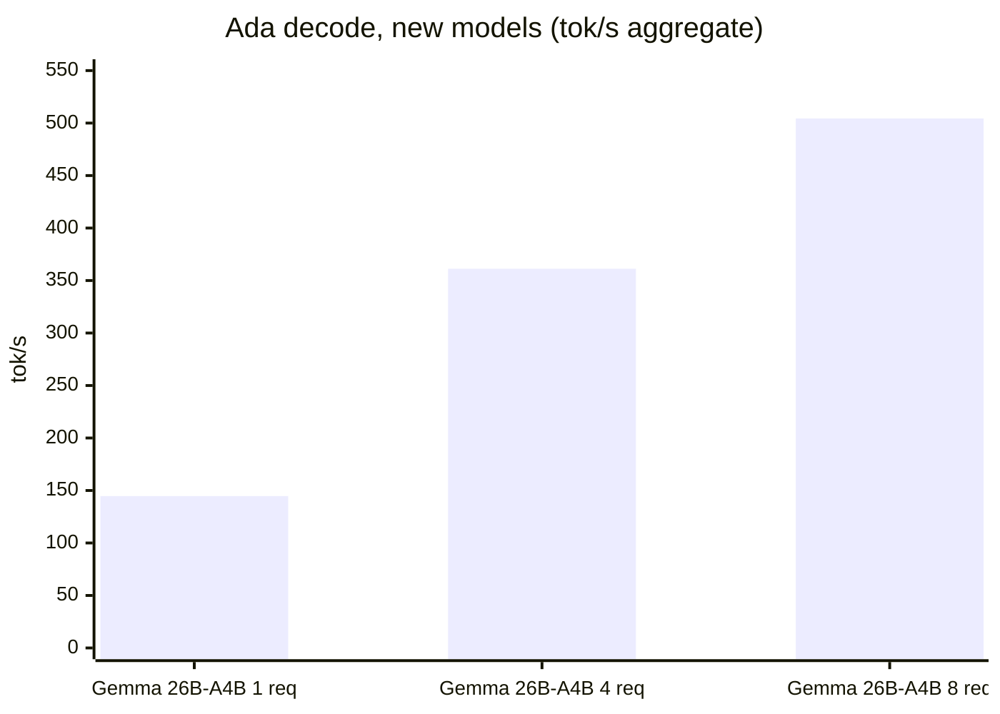
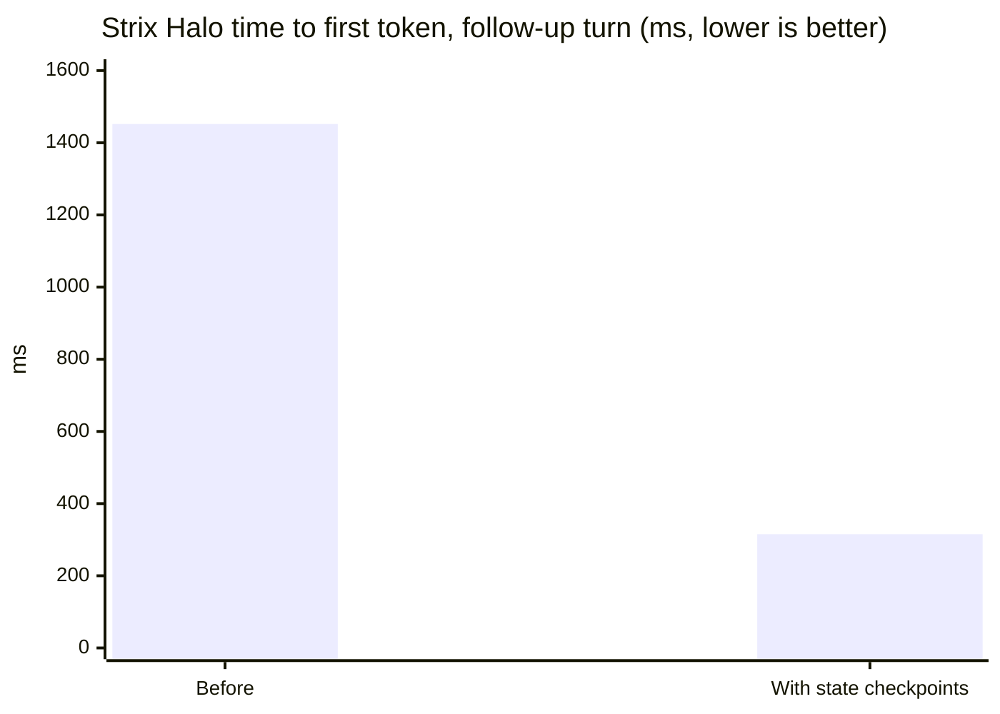
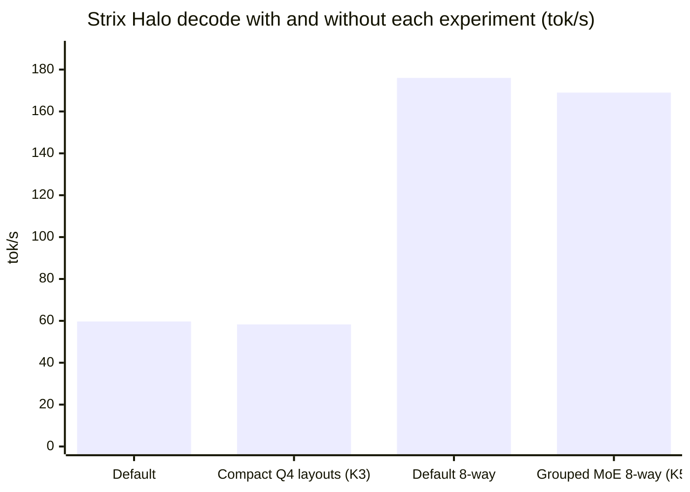
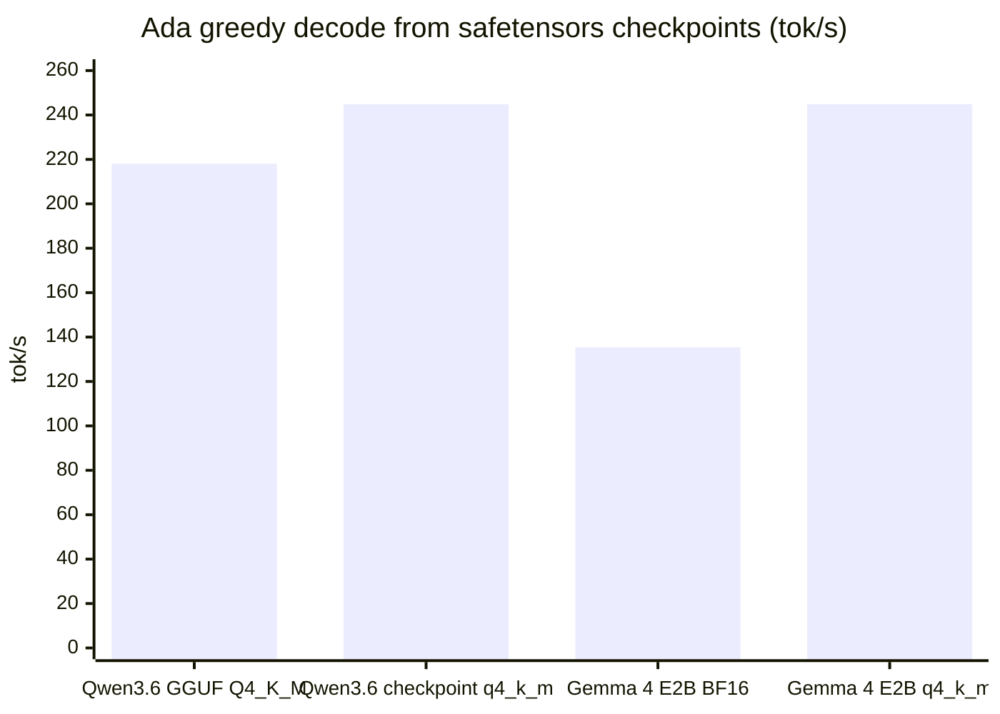

# rllm throughput progression

Where tokens per second stand after the performance-review work of November 2026, and how each change moved them.

All measurements are on **Qwen3.6-35B-A3B Q4_K_M** unless noted. "Before" is the build that was deployed before this work. Each change was measured with the same binary, with and without it, in the same session wherever possible. Sources: `reports/rllm performance review 2026-11.md` (implementation status) and `docs/safetensors.md`.

The charts are Mermaid; each has a table with the exact numbers underneath.

## Where things stand

| | Strix Halo (gfx1151, HIP) | RTX 6000 Ada (sm_89, CUDA) |
|---|---|---|
| Prompt, 512 tokens | 1,389 → **1,603** tok/s (+15%) | 6,282 → **7,218** tok/s (+15%) |
| Prompt, 4,096 tokens | 1,635 → **1,737** tok/s (+6%) | 7,201 → **8,962** tok/s (+24%) |
| Greedy decode | 59.6 → **59.7** tok/s | 207 → **214.6** tok/s (+3.7%) |
| Sampled decode | 50.7 → **57.6** tok/s (+14%) | 133.9 → **212.6** tok/s (+59%) |
| MTP decode (speculative) | 77.6 → **77.7** tok/s | — |
| 8-way decode | ~175 → ~175 tok/s | 783 → **780** tok/s |

Decode on Strix Halo is bound by memory bandwidth, so the cuts in kernel launches barely show there. They show on the Ada, where launch overhead is a bigger share of each step.

## Strix Halo: prompt processing, step by step

| Step | pp512 (tok/s) | What changed |
|---|---|---|
| Before | 1,389 | deployed build |
| Fusions and scans | 1,441 | K1a–K1f fused kernels, K4, P2–P4 |
| + 32-pair MoE tiles (P1) | **1,603** | small-batch MoE tiles below 48 pairs per expert (pp1024: 1,716 → 1,827) |

## Strix Halo: sampled decode, step by step

| Step | tok/s | What changed |
|---|---|---|
| Sampled, before | 50.7 | deployed build |
| Sampled, before S1 | 51.2 | launch and readback cuts (S2–S6, K1) |
| Sampled, + S1 | **57.6** | sampler: histogram top-k bound, candidates compacted in shared memory |
| Greedy (no sampling) | 59.7 | the ceiling sampled decode is approaching |

## RTX 6000 Ada: before and after

| | Before | After | Change |
|---|---|---|---|
| Prompt, 512 tokens | 6,282 | **7,218** | +15% |
| Prompt, 4,096 tokens | 7,201 | **8,962** | +24% |
| Greedy decode | 207 | **214.6** | +3.7% |
| Sampled, Qwen's settings | 133.9 | **212.6** | +59% |
| Sampled, top-p only | 159.7 | **211.2** | +32% |
| 8-way decode | 783 | 780 | — |

Through the server (300 tokens, one request), greedy went from 212.5 to 217.7 tok/s. Sampled decode is now as fast as greedy: 212.6 with Qwen's settings and 211.2 with top-p only.

## Speculation past 8 tokens per step (RTX 6000 Ada)

A step of 9 to 16 tokens used to leave the matvec kernels for the matmul path and cost about 50% more than an 8-token step, so speculation stopped at 8 tokens per step and switched off with 5 or more requests decoding. The matvec kernels are now built a second time for up to 16 tokens (steps of 1 to 8 keep the 8-token build), and each step's MTP draft length is tuned by measurement.

| Tokens per step | Before | After |
|---|---|---|
| 1 | 217 | 217 |
| 8 | 814 | 815 |
| 9 | 608 | 846 |
| 12 | 702 | **938** |
| 16 | 830 | **1,044** |

Serving Qwen3.6-35B-A3B in its default mode (batch-invariant, MTP), 512 tokens per request:

| Concurrent requests | Before | After | Change |
|---|---|---|---|
| 1 | 311 | 312 | — |
| 2 | 448 | 453 | +1% |
| 4 | 628 | 639 | +2% |
| 8 | 701 | **793** | +13% |
| 16 | 700 (`--parallel` capped at 8) | **868** (`--parallel 16`) | +24% |

Batch-invariant mode now allows 16-token decode steps and `--parallel 16`: a token in a 12- or 16-token step gives bit for bit the logits of a step of its own (checked on CUDA and HIP). On Strix Halo, bound by memory bandwidth, the same build is within ±3% up to 8 requests and +5% at 16; steps of 12 tokens run 176 instead of 143 tok/s there.

A draft model and prompt lookup keep 8-token steps: with a separate draft model, longer steps measured slower (a draft skipped for a step has to catch up later).

## New models: Gemma 4 26B-A4B and Mistral's Tekken family (RTX 6000 Ada)

Neither ran in rllm before, in any format. Both now run from a GGUF or straight from the Hugging Face checkpoint.

| Model | Format | What was checked | Result |
|---|---|---|---|
| Gemma 4 26B-A4B (128 experts, top 8) | Q8_0 GGUF | logits against llama.cpp, 45 positions | KL mean 0.05 against llama.cpp's default; llama.cpp's own two modes differ more (0.16) |
| Gemma 4 26B-A4B | BF16 checkpoint, `--quantize q8_0` | same prompt as the GGUF | same answer, logprobs within Q8 rounding |
| Gemma 4 26B-A4B | Q8_0 GGUF | decode, 1 / 4 / 8 requests | 144.7 / 361.2 / 504.4 tok/s |
| Gemma 4 26B-A4B | Q8_0 GGUF | own rounding noise (512- vs 16-token prefill chunks) | mean KL 0.20, against 0.003–0.004 for Qwen3.6-35B-A3B and Nemotron E4B; GPU model tests pass against this floor |
| Mistral Nemo 12B (Tekken) | BF16 checkpoint and GGUF | served on CUDA | identical prompt, text and logprobs |
| Tekken tokenizers (Nemo, Small 3, Ministral 8B) | tokenizer.json | ids against Hugging Face `tokenizers`, 10 texts | identical |

## Time to first token with hybrid checkpoints

Qwen3.5/3.6 hybrids now keep recurrent-state checkpoints in the prefix cache, so a follow-up turn resumes instead of re-reading the whole conversation.

| | Time to first token |
|---|---|
| Before | 1,452 ms |
| With state checkpoints | **315 ms** (output identical to a cold run) |

## Tried and not kept

These were implemented and measured. Each was slower or no better, so the default stays as it was. Grouped MoE decode, the chunked kernel and the gate/up block size stay available behind environment switches; the compact weight layouts were reverted.

| Experiment | Default | With it | Decision |
|---|---|---|---|
| K3 compact Q4 scale blocks, decode | 59.7 | 58.3 | reverted |
| K3 compact Q6 scale blocks, decode | 59.6 | 59.4 | reverted |
| K5 grouped MoE, 8-way decode (Strix Halo) | 176 | 169 | opt-in, `RLLM_MOE_GROUP=1` |
| K5 grouped MoE, MTP (Strix Halo) | 77.5 | 74.9 | opt-in |
| K5 grouped MoE, 8-way decode (Ada) | 780 | 733 | opt-in |
| Chunked Gated DeltaNet, pp512 (Strix Halo) | 1,431 | 1,256 | opt-in, `RLLM_GDN_CHUNKED=1` |
| Chunked Gated DeltaNet, pp4096 (Ada) | 8,962 | 7,674 | opt-in |
| K6 smaller MoE gate/up blocks, decode | 59.7 | 59.5 | no change, `RLLM_MOE_GLU_THREADS` |
| K2 graphs for mixed steps | — | — | in use since speculation goes past 8 tokens per step (see above) |

## Safetensors checkpoints, quantized as they load (Ada)

Checkpoints can now be served directly, quantized at load with `--quantize q8_0|q4_k_m`. Greedy decode, one request:

| Model | Source | GPU memory | Ready after | Greedy decode |
|---|---|---|---|---|
| Qwen3.6-35B-A3B | published Q4_K_M GGUF | 23.1 GB | 11 s | 218.1 tok/s |
| Qwen3.6-35B-A3B | checkpoint, `--quantize q4_k_m` | 22.5 GB | 187 s | **244.8 tok/s** |
| Qwen3.6-35B-A3B | checkpoint, `--quantize q8_0` | 37.6 GB | 55 s | — |
| Gemma 4 E2B | checkpoint, BF16 | — | — | 135.4 tok/s |
| Gemma 4 E2B | checkpoint, `--quantize q4_k_m` | — | — | **244.9 tok/s** |

The Qwen3.6 checkpoint at Q4_K_M decodes faster than the published GGUF, which probably keeps more tensors at higher precision than llama.cpp's default mix. Quality matches llama.cpp: on Qwen3-0.6B, wikitext-2 perplexity is 23.5408 for ours against 23.5402 for llama.cpp's Q4_K_M.
